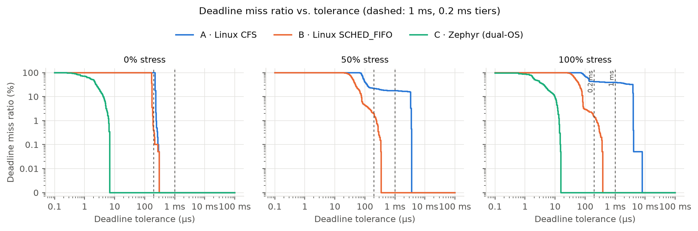
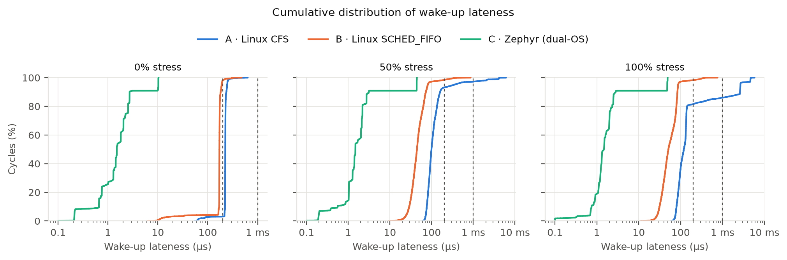
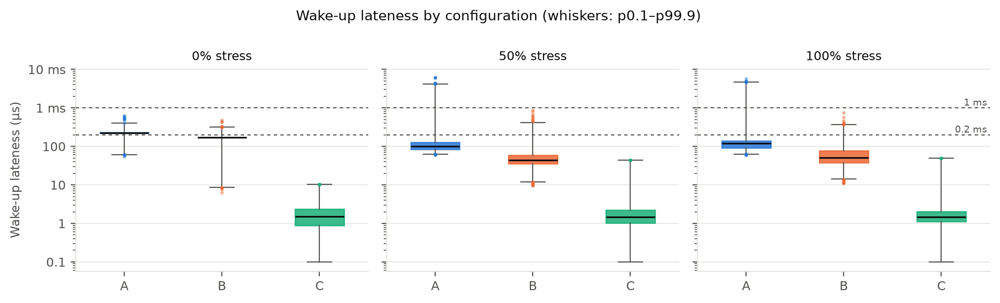
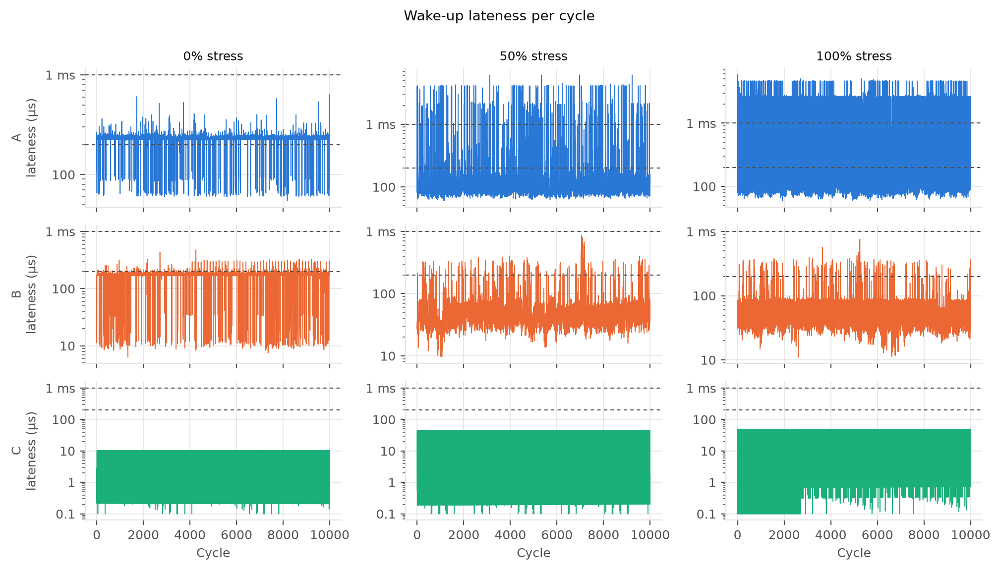

# Week 4–6 Lab Progress Report
### Heterogeneous OS Benchmarking for Real-Time Edge Control on Asymmetric Hardware
**Course:** Operating Systems (Fall 2026) — National Chung Cheng University (CCU)  
**Author / Lab Lead:** Quang-Huy Nguyen  
**Sprint Window:** Weeks 4–6 (Sep 30 – Oct 20, 2026)  
**Execution Date:** October 10–18, 2026  
**Target Milestone:** Milestone 2: Formal Written Progress Report (Due Oct 27, 2026; moved from Oct 20)

---

## 1. Executive Summary

During Weeks 4–6, physical hardware bring-up, asymmetric dual-threaded benchmarking, and high-precision dual-perspective real-time metrology were executed on the **Arduino UNO Q** platform. All objectives assigned to Huy under **Phase 2 (Tasks P2.1 – P2.10)** in the Project Scope Statement were successfully achieved ahead of the Milestone 2 deadline.

To capture rare tail events such as kernel background flushes (`dirty_writeback_centisecs`), all experimental trials were scaled to **$10,000\text{ continuous cycles}$ ($100.0\text{ seconds}$ unbroken execution per trial)** across Configurations A and B and the **Config C baseline (no IPC)**, each at 0%, 50%, and 100% stress (9 runs), logging a total of **$90,000\text{ cycles}$ from live physical hardware**. The Linux→MCU IPC path of the full Config C is scheduled for Phase 5.

### Key Milestones Achieved:
1. **Physical Board Bring-Up & Dual-Threaded Architecture:**  
   Established root shell access to the Qualcomm QRB2210 quad-core Cortex-A53 via ADB over USB on Debian 13 Linux. Built an in-tree Cooley-Tukey 1024-point Radix-2 FFT analytics engine coupled with an asymmetric dual-threaded benchmark harness (`mpu_linux/workload/dual_thread_bench.c`) separating the 10 ms real-time control tick from background vibration analytics.
2. **Comprehensive Multi-Resource Industrial Benchmark (10,000 Cycles / Tier):**  
   Executed a unified industrial stress suite combining multi-worker CPU compute saturation, eMMC flash I/O, virtual memory paging pressure, and Core 0 affinity contention across 0% (Idle), 50% (Standard Load), and 100% (Maximum Storm) tiers.
3. **Decisive Empirical Contrast Across 3 OS Architectures:**  
   - **Config A (Standard Linux CFS):** Degraded severely under load. At 100% stress, tail lateness $p99.9$ reached **4.700 ms** and deadline misses rose to **13.91% DMR (1,391 / 10,000 misses)** under the 1.0 ms threshold. Worst-case lateness peaked at **6.120 ms** in the 50% tier ($> 6\times$ the 1.0 ms tolerance; 5.805 ms at 100%). Under the tighter 0.2 ms tolerance, **96.93%** of cycles missed even at idle (see §6.5 for why idle is slower than loaded).
   - **Config B (Linux `SCHED_FIFO` 90 + `mlockall`):** Bounded peak lateness to **0.865 ms** with strictly **0.00% DMR (0 / 30,000 misses)** across all stress tiers under the 1.0 ms threshold.
   - **Config C baseline (Zephyr-based MCU loop on the STM32, no IPC yet):** Mean lateness of **2.29–5.70 µs** (measured from the best cycle, so not comparable with the A/B means; see §5.1), worst-case lateness of at most **49.08 µs**, and **0.00% DMR** under both 1.0 ms and 0.2 ms tolerances, even while the Linux MPU ran the 100% storm. Linux stress still raised the MCU's worst case about 5× (10.3 → 49.1 µs), so isolation is strong but not total. No setpoints crossed the Linux→MCU link during these runs; that is Phase 5.
4. **Dual-Perspective Hardware Referee Metrology:**  
   Configured a second physical Arduino UNO Q as an independent **Hardware Referee** running a dedicated 160 MHz STM32 EXTI interrupt service routine on pin D2. Captured 10,000 physical pulses per stress tier with zero missed pulses. The referee's periods differ from the internal DWT periods by a constant ≈390 ppm. This was first attributed to the two boards' clocks, but the referee timestamps with a Zephyr counter that loses cycles while the chip sleeps, so much of the offset may be the referee's own loss (§7.3). The referee is being moved to DWT timestamps.

---

## 2. In-Lab Work Breakdown & Milestone Checklist

| WBS Task | Description | In-Lab Actions Taken by Huy | Deliverables / Artifacts | Status |
| :---: | :--- | :--- | :--- | :---: |
| **P2.1** | Linux Processor Connection | Connected host PC to Arduino UNO Q via ADB over USB (`3125036249`). Verified Debian 13 (trixie) terminal on Qualcomm QRB2210. | Terminal session log | ✅ Done |
| **P2.1b** | IPC Architecture Investigation | Mapped hardware USB interfaces: `MI_00` routes to ADB shell on Linux QRB2210; `MI_01` routes to serial `COM3` on STM32 MCU. | Hardware mapping documentation | ✅ Done |
| **P2.2** | System Package Installation | Fixed DNS resolution (`/etc/resolv.conf`), granted passwordless `sudo` to user `arduino`, installed `build-essential`, `stress-ng`, and Python. | Board system setup | ✅ Done |
| **P2.3** | Dataset Ingestion | Downloaded 4 baseline CWRU 0 HP `.mat` files, segmented into 594 windows (1024 samples each), and exported 100 binary test frames. | `data/processed/cwru_test_frames.bin` | ✅ Done |
| **P2.4** | Dual-Threaded C Benchmark | Built Option 2 normalized dual-threaded C benchmark (`dual_thread_bench.c`, `fft_math.c`) on target Cortex-A53 with `-O2 -pthread -lm`. | `build/dual_thread_bench` | ✅ Done |
| **P2.5** | Config A (CFS Baseline) | Evaluated standard CFS timeslicing across 0%, 50%, and 100% stress within the unified multi-resource benchmark harness ($10,000\text{ cycles/run}$). | `results/raw/A_*.csv` | ✅ Done |
| **P2.6** | Config B (RT-FIFO 90 + `mlockall`) | Evaluated real-time determinism across 0%, 50%, and 100% stress within the unified multi-resource benchmark harness ($10,000\text{ cycles/run}$). | `results/raw/B_*.csv` | ✅ Done |
| **P2.7** | Unified Multi-Resource Benchmark Orchestration | Unified industrial stress runner combining Core 0 CPU contention, L2 cache thrashing, eMMC I/O, and VM pressure into a single script. | `benchmarks/run_benchmark.sh` | ✅ Done |
| **P2.8** | Telemetry Parsing & KPIs | Automated extraction of lateness, WCL, tail ($P_{99.9}$), jitter, DMR, and kernel context switches/faults. | `benchmarks/analysis/analyze_latency.py` | ✅ Done |
| **P2.9** | Hardware Referee Bench for Config C | Deployed Board 2 as external hardware referee on pin `D2` (160 MHz STM32 EXTI interrupt). Verified 10,000-cycle dual metrology. | `benchmarks/referee/`, `results/raw/config_c_*.csv` | ✅ Done |
| **P2.10** | Publication Figures & Progress Report | Ingested full 90,000-cycle dataset into statistical analysis pipeline; generated all 4 IEEE publication figures. | `results/plots/*.png`, `results/summary.md` | ✅ Done |

---

## 3. Physical Hardware & Operating System Specifications

- **Target Device (DUT):** Arduino UNO Q (Hostname: `FormuCut`, Serial: `3125036249`)
- **Reference Device (Referee):** Arduino UNO Q (Hostname: `Arduino`, Serial: `253074993`)
- **Microprocessor:** Qualcomm QRB2210 Quad-Core Kryo-V2 Cortex-A53 @ 2.016 GHz (`aarch64`)
- **Microcontroller Core:** STM32U585 Arm Cortex-M33 @ 160 MHz (with hardware DWT cycle counter)
- **System Memory:** 3.6 GiB total LPDDR4 (2.8 GiB available)
- **Storage:** eMMC Flash (Ext4 root filesystem)
- **Operating System:** Debian GNU/Linux 13 (trixie)
- **Kernel Version:** Linux `6.16.7-g0dd6551ae96b #1 SMP PREEMPT`
- **Compiler:** `gcc (Debian 14.2.0-19) 14.2.0`
- **CPU Scaling Governor:** `performance` (All 4 cores locked permanently to 2.016 GHz)
- **Stress Benchmark Tool:** `stress-ng v0.19.02`

---

## 4. Technical Details of the Benchmark & OS Configurations

### 4.1 Asymmetric Dual-Threaded Decoupling Architecture

To mirror real-world industrial edge controllers, the benchmark implements **Option 2 (Decoupled Dual-Thread Model)**:

```
+-----------------------------------------------------------------------------------+
|                            QUALCOMM QRB2210 (LINUX MPU)                           |
|                                                                                   |
|  [ Thread 1: 10 ms Control Reflex ] <── Atomic Setpoint ── [ Thread 2: ~85 ms ]  |
|  - clock_nanosleep(TIMER_ABSTIME)                          - 1024-Point FFT       |
|  - Buffers timestamp in RAM                                - CWRU AI Analytics    |
|         │                                                          │              |
|         ▼                                                          ▼              |
|   Config A (CFS) vs Config B (SCHED_FIFO 90)              Core 0 at 50/100%       |
+-----------------------------------------------------------------------------------+
```

- **Thread 1 (Control Reflex Loop — 10.00 ms Strict Cadence):**  
  Periodically wakes up every $10.00\text{ ms}$ ($100\text{ Hz}$) using `clock_nanosleep(CLOCK_MONOTONIC, TIMER_ABSTIME)`. It atomically reads the motor speed setpoint (`atomic_load`), records wake-up timestamp telemetry into an in-memory RAM buffer, and immediately sleeps. Zero disk or console I/O is performed inside the loop.
- **Thread 2 (Cognitive Brain / Vibration Analytics — ~85.33 ms Period):**  
  Periodically processes 1024-point vibration frames from `data/processed/cwru_test_frames.bin`. It applies a Hanning window, computes a Radix-2 FFT, extracts spectral fault peaks, and atomically updates the motor setpoint (`atomic_store`). It shares no lock with Thread 1 (the setpoint is a single atomic), so it can never block it on a lock. It does compete for CPU time: at 50% and 100% stress the whole process is pinned to Core 0, so in Config A both threads share that core at the same priority. In Config B, Thread 1 preempts it.

### 4.2 Configuration Implementations: Config A vs. Config B vs. Config C

1. **Config A — Standard Linux CFS (`SCHED_OTHER`):**
   - **OS Policy:** Completely Fair Scheduler (CFS). Tracks CPU execution via virtual runtime ($vruntime$).
   - **Implementation:** Both Thread 1 and Thread 2 run under default Linux timeslicing (`nice 0`, priority 0) without memory locking. At 50% and 100% stress both threads are pinned to Core 0, as in Config B.
2. **Config B — Hardened Linux Real-Time (`SCHED_FIFO` 90 + `mlockall`):**
   - **OS Policy:** Real-time FIFO policy at **Priority 90** (`SCHED_FIFO`). Grants absolute preemption rights over all CFS userspace processes.
   - **Virtual Memory Locking:** Calls `mlockall(MCL_CURRENT | MCL_FUTURE)` and prefaults the entire telemetry buffer into physical DRAM at startup, permanently preventing page faults.
   - **Thread Isolation:** Thread 2 is explicitly constrained to `SCHED_OTHER` (`PTHREAD_EXPLICIT_SCHED`) so it never contends for real-time priority against Thread 1.
   - **Core 0 Pinning (50% and 100% tiers only):** At 50% and 100% stress, both threads are pinned to **Core 0** (`sched_setaffinity`), where the `stress-ng` CPU workers are also pinned, to maximize contention. At 0% the threads float across all cores, so comparing 0% with 50/100% changes both load and affinity. Test 3 (floating vs. Core-0-pinned, Config B, 100% stress) isolates the affinity effect.
3. **Config C baseline — Zephyr-based MCU loop, no IPC yet:**
   - **Platform:** Arduino core on Zephyr RTOS, running on the dedicated **Cortex-M33 @ 160 MHz**. The 10 ms loop is an Arduino sketch scheduled with `micros()` (it sleeps with `delay(6)`, then spin-waits to the deadline), not a Zephyr `k_timer`.
   - **Hardware Isolation:** The loop runs entirely on the MCU, physically separate from the Qualcomm MPU. The MPU runs background Linux services and the stress load while the MCU toggles GPIO pin D2 and logs DWT cycle timestamps.
   - **Not yet included:** no setpoints are sent from Linux to the MCU during these runs. The full Config C, with the Linux analytics sending setpoints over the RouterBridge, is Phase 5.

### 4.3 Real-World Industrial Stress Tiers

To simulate actual factory operating conditions rather than artificial loops, the stress matrix is defined as follows:

| Stress Tier | Simulated Factory Environment | Exact `stress-ng` Configuration |
| :---: | :--- | :--- |
| **0% (Idle)** | Normal baseline operation; only benchmark threads execute. | *(None — benchmark runs unperturbed)* |
| **50% (Standard Load)** | Routine factory shift: Continuous AI inference + periodic vibration logging to eMMC + MQTT telemetry buffering in RAM. | `stress-ng --cpu 1 --taskset 0 --hdd 1 --vm 1 --vm-bytes 25% --quiet` |
| **100% (Maximum Storm)** | Worst-case factory anomaly: Multi-model AI inference + inspection camera L2 cache thrashing + continuous eMMC flash logging + OTA update memory pressure. | `stress-ng --cpu 2 --taskset 0 --cache 2 --hdd 1 --vm 1 --vm-bytes 50% --quiet` |

### 4.4 Experimental Protocol & Sampling Rigor

To ensure statistical significance, eliminate transient initialization anomalies, and prevent thermal or scheduler throttling from skewing results, the following testing protocol was enforced:

1. **Repetitions & Sample Sizes per Trial:**
   - **Full Industrial Matrix:** Each experimental condition was evaluated across **$N = 10,000\text{ consecutive cycles}$** ($100.0\text{ seconds}$ unbroken continuous run at $10.0\text{ ms}$ tick cadence). Across the 9 primary runs (Configs A and B and the Config C baseline without IPC, $\times$ 3 stress tiers), a total of **$90,000\text{ discrete actuation cycles}$** were logged from live physical hardware.
   - **Kernel Background Events:** The $100\text{-second}$ window is critical because Linux dirty page flush cycles (`dirty_writeback_centisecs`) trigger every 5–30 seconds; 10,000 cycles span several such flush periods, so their spikes appear in the tail statistics. With one 10,000-cycle run per condition, $p99.9$ rests on about 10 samples, and $p99.99$ would be just the single maximum, so it is not reported.
2. **Stress Schedulers & Stabilization Lead Time:**
   - For every stressed trial (50% and 100%), background `stress-ng` worker processes were initialized with a mandatory **$3.0\text{-second}$ pre-run stabilization window** before starting timer telemetry. This ensured that thread creation overhead, file allocation on eMMC, and memory page population reached full steady-state saturation prior to timing acquisition.
3. **Inter-Test Cooldown:**
   - Between consecutive experimental runs, a mandatory **$5.0\text{-second}$ idle rest interval** was enforced with active background worker purging (`sudo pkill -9 stress-ng`), to let the cores cool between runs and reduce the risk of thermal throttling. SoC temperature was not logged during the runs.
4. **Hardware Clock & Environmental Controls:**
   - All 4 Cortex-A53 cores were locked to the **`performance` governor at $2.016\text{ GHz}$**, eliminating dynamic voltage/frequency scaling (DVFS) transition penalties.
   - Telemetry timestamps were captured directly via `clock_gettime(CLOCK_MONOTONIC)` into pre-allocated memory buffers (`RAM`), with disk I/O to eMMC deferred until after test completion to eliminate observer effects.

---

## 5. Unified Multi-Resource Empirical Benchmark (Definitive Results)

All experiments were executed on physical hardware (**Arduino UNO Q Qualcomm Cortex-A53 and STM32U585**) for **10,000 continuous cycles (100.0 seconds)** per condition following the protocol above.

### 5.1 Consolidated Empirical Results Matrix (10,000 Cycles / Run):

| Configuration | Stress Tier | Avg Lateness ($\bar{L}$) | Worst-Case Lateness (Max) | Tail ($P_{99.9}$) | Timing Jitter ($\sigma_L$) | Deadline Miss Ratio (DMR) | Deadline Misses ($L_k > 1\text{ ms}$) | Invol Ctx Sw (`ru_nivcsw`) | Minor Page Faults (`ru_minflt`) |
| :---: | :---: | :---: | :---: | :---: | :---: | :---: | :---: | :---: | :---: |
| **Config A (Linux CFS)** | **0% (Idle)** | 0.223 ms | **0.634 ms** | 0.401 ms | 0.030 ms | **0.00%** | **0 / 10,000** | 0 | 152 |
| **Config A (Linux CFS)** | **50% (Composite)** | 0.188 ms | **6.120 ms** | 4.179 ms | 0.482 ms | **2.76%** | **276 / 10,000** | 39 | 148 |
| **Config A (Linux CFS)** | **100% (Storm)** | 0.516 ms | **5.805 ms** | 4.700 ms | 1.041 ms | **13.91%** | **1,391 / 10,000** | 57 | 153 |
| **Config B (`SCHED_FIFO` 90 + `mlock`)** | **0% (Idle)** | 0.168 ms | **0.478 ms** | 0.316 ms | 0.034 ms | **0.00%** | **0 / 10,000** | 0 | **0** |
| **Config B (`SCHED_FIFO` 90 + `mlock`)** | **50% (Composite)** | 0.052 ms | **0.865 ms** | 0.413 ms | 0.038 ms | **0.00%** | **0 / 10,000** | 27 | **0** |
| **Config B (`SCHED_FIFO` 90 + `mlock`)** | **100% (Storm)** | 0.060 ms | **0.759 ms** | 0.366 ms | 0.039 ms | **0.00%** | **0 / 10,000** | 25 | **0** |
| **Config C baseline (no IPC)** | **0% (Idle)** | 0.002 ms | **0.010 ms** | 0.010 ms | 0.003 ms | **0.00%** | **0 / 10,000** | n/a | n/a |
| **Config C baseline (no IPC)** | **50% (Composite)** | 0.005 ms | **0.045 ms** | 0.044 ms | 0.012 ms | **0.00%** | **0 / 10,000** | n/a | n/a |
| **Config C baseline (no IPC)** | **100% (Storm)** | 0.006 ms | **0.049 ms** | 0.049 ms | 0.013 ms | **0.00%** | **0 / 10,000** | n/a | n/a |

*(Statistical post-processing generated via `benchmarks/analysis/analyze_latency.py`; summary table archived in `results/summary.md`; raw telemetry logs archived in `results/raw/[ABC]_*.csv`). `ru_nivcsw` and `ru_minflt` are process-wide counts (`getrusage(RUSAGE_SELF)`) covering both threads, not Thread 1 alone; they do not exist on the MCU and were not measured for Config C. The program samples them every 500 cycles, so the columns show the change from cycle 0 to cycle 9,500 (computed from the raw CSVs; earlier versions of this table listed values that the raw files do not reproduce).*

*Comparability: A/B lateness is absolute, measured against the real schedule $R_k$ with `CLOCK_MONOTONIC`. Config C lateness is wake-only: it is measured from the best cycle after fitting the period (+545.5 ppm, see §7.3), so it is a lower bound and its mean is not comparable with the A/B means. Compare jitter ($\sigma_L$), $P_{99.9}$ and worst-case lateness across platforms, not mean lateness.*

### 5.2 Industrial Precision Tolerance Sensitivity Breakdown ($1.0\text{ ms}$ vs $0.5\text{ ms}$ vs $0.2\text{ ms}$)

Evaluating the exact same telemetry data under tighter industrial tolerances reveals the **physical determinism boundary of Linux `SCHED_FIFO` vs. Zephyr RTOS**:

| Configuration | Stress Tier | DMR @ 1.0 ms (Standard Coarse) | DMR @ 0.5 ms (Medium Industrial) | DMR @ 0.2 ms (Precision $200\text{ }\mu\text{s}$) | Deadline Misses @ $200\text{ }\mu\text{s}$ |
| :---: | :---: | :---: | :---: | :---: | :---: |
| **Config A (CFS)** | **0% (Idle)** | **0.00%** (0) | **0.00%** (0) | **96.93%** (9,693) | **9,693 / 10,000** |
| **Config A (CFS)** | **50% (Composite)** | **2.76%** (276) | **2.91%** (291) | **6.83%** (683) | **683 / 10,000** |
| **Config A (CFS)** | **100% (Storm)** | **13.91%** (1,391) | **14.12%** (1,412) | **18.46%** (1,846) | **1,846 / 10,000** |
| **Config B (FIFO 90)** | **0% (Idle)** | **0.00%** (0) | **0.00%** (0) | **1.94%** (194) | **194 / 10,000** |
| **Config B (FIFO 90)** | **50% (Composite)** | **0.00%** (0) | **0.38%** (38) | **1.55%** (155) | **155 / 10,000** |
| **Config B (FIFO 90)** | **100% (Storm)** | **0.00%** (0) | **0.29%** (29) | **1.73%** (173) | **173 / 10,000** |
| **Config C baseline (no IPC)** | **0% (Idle)** | **0.00%** (0) | **0.00%** (0) | **0.00%** (0) | **0 / 10,000** |
| **Config C baseline (no IPC)** | **50% (Composite)** | **0.00%** (0) | **0.00%** (0) | **0.00%** (0) | **0 / 10,000** |
| **Config C baseline (no IPC)** | **100% (Storm)** | **0.00%** (0) | **0.00%** (0) | **0.00%** (0) | **0 / 10,000** |

### 5.3 Consolidated Publication Figures

The following IEEE-formatted figures illustrate the empirical distributions across all 90,000 hardware execution cycles:

#### 1. Deadline Miss Ratio vs. Tolerance Curve:


#### 2. Empirical Cumulative Distribution Function (CDF):


#### 3. Log-Scale Lateness Box Plot:


#### 4. Temporal Stability (100-Second Lateness Time Series):


---

## 6. Deep Operating System Analysis & Core Findings

### 6.1 Catastrophic CFS Preemption Collapse (Why Config A Failed)
- Under the Completely Fair Scheduler (CFS), the Linux kernel treats all processes on Core 0 as equal peers.
- When background stress workers saturate Core 0, CFS forces Thread 1 to yield its timeslice. Worst-case lateness rose from **0.634 ms to 6.120 ms**, more than 6× the 1.0 ms tolerance.
- Deadline misses exploded under multi-resource load: **$0.00\% \to 2.76\% \to 13.91\%$ (1,391 misses)**. For a 10 ms actuation loop, missing nearly 14% of cycles would be unacceptable.
- **Hypothesis check:** the scope statement predicted DMR > 0% and WCL > 10 ms for Config A under heavy load. This was partly met: DMR > 0% was confirmed (13.91% at 100% stress), but WCL peaked at 6.12 ms (50% tier), below 10 ms.

### 6.2 Deterministic Shield of POSIX Real-Time (`SCHED_FIFO` 90)
- In Linux, real-time priorities (1–99) mathematically outrank normal CFS tasks (`SCHED_OTHER`, priority 0).
- The instant Thread 1's 10 ms monotonic timer fires, the kernel immediately evicts background CFS workers from Core 0.
- Worst-case lateness remained strictly bounded: **$0.478\text{ ms} \to 0.865\text{ ms} \to 0.759\text{ ms}$**, maintaining **strictly 0.00% DMR (0 misses)** across all tiers under 1.0 ms tolerance.
- `ru_nivcsw` cannot show whether Thread 1 itself was preempted: it is a process-wide count that includes the analytics thread (Config B: 27 at 50% and 25 at 100% stress).

### 6.3 Virtual Memory Locking (`mlockall`)
- In Linux, default dynamic memory allocation (`malloc`) uses demand paging: physical RAM pages are only allocated on first write, triggering a **Minor Page Fault (`ru_minflt`)**.
- Config B calls `mlockall(MCL_CURRENT | MCL_FUTURE)` and prefaults the telemetry buffer at startup, so its pages stay in physical RAM.
- In the main matrix, Config A incurs 148–153 minor page faults per run (cycles 0–9,500) in every stress tier, while Config B incurs none. The count matches the record buffer: 10,000 records × 64 bytes ≈ 156 pages of 4 KiB, which Config A allocates with `malloc` and touches for the first time inside the timing loop, page by page. Config B prefaults and locks it. Each minor fault costs only microseconds, so this does not explain Config A's millisecond-scale misses. (Page size of 4 KiB assumed, not checked on the board.) Test 4 (`test4_memory_no_mlock.csv` vs. `test4_memory_with_mlock.csv`) was meant to isolate the effect of memory locking, but it points the opposite way: with `mlockall` the mean lateness is 413 µs and 81% of cycles exceed 0.2 ms, without it 208 µs and 46% (2,000 cycles each). Either the test setup does not isolate memory locking, or this is a real effect. Until it is understood, Test 4 is not used as evidence for `mlockall`.

### 6.4 CPU Frequency Control (Design Choice)
- Under the default `schedutil` governor, the kernel changes CPU frequency with load (e.g. to lower operating points such as 1.3 GHz on this chip), and each frequency change can add wake-up delay.
- To remove this variable, the harness locks all 4 Cortex-A53 cores to the **`performance` governor at 2.016 GHz** before every run, so all stress tiers run at the same clock frequency. This is a design choice, not a measured result: no runs were made under `schedutil`, so its effect on lateness was not quantified here. The governor does not control CPU idle states (cpuidle), so idle-state exit latency may still contribute to jitter.

### 6.5 The 0.2 ms Boundary of `SCHED_FIFO` on Stock Linux
- While `SCHED_FIFO` achieved 0.00% DMR under the coarse 1.0 ms tolerance, evaluating it at a high-precision industrial threshold ($200\text{ }\mu\text{s} = 0.20\text{ ms}$) revealed **155–194 deadline misses (~1.5–1.9% DMR)**.
- **Idle is slower than loaded.** Median lateness at 0% stress is 224 µs (A) and 171 µs (B). Under load, B drops to 44.5 µs (50%) and 51.0 µs (100%), and Tests 3 and 5 (Config B under a CPU-only load, `stress-ng --cpu 4`) show medians of 36–43 µs. This is why 97% of Config A's idle cycles miss 0.2 ms, and why B misses 1.94% at idle. The likely cause is wake-up from deep CPU idle states when nothing keeps the core busy (§6.4: the governor fixes the frequency, not the idle states). Not yet confirmed; a check would be to re-run B at 0% with deep idle states disabled (e.g. holding `/dev/cpu_dma_latency` at 0).
- **Likely causes under load (not traced in these runs):** B still misses 0.2 ms in 1.55–1.73% of cycles at 50/100% stress. The stock kernel (`PREEMPT`, not `PREEMPT_RT`) has non-preemptible sections such as driver spinlocks and interrupt-disabled regions (`local_irq_disable`), plus shared L2 cache contention, none of which `SCHED_FIFO` can bypass. Confirming this would need kernel tracing (e.g. `ftrace`). At idle, the idle-state effect above weakens this explanation.
- **Conclusion:** on this stock kernel, `SCHED_FIFO` meets a 1.0 ms tolerance but not a 0.2 ms one. A `PREEMPT_RT` kernel was not tested and might narrow this gap.

---

## 7. Dual-Perspective Real-Time Metrology for Config C (DWT vs. Hardware Referee)

In Config A and Config B, the 10 ms control loop ran within Linux userspace, recording timestamps into memory. For **Config C baseline (Zephyr-based MCU loop on the STM32, no IPC)**, the real-time periodic tick runs directly on the dedicated **STM32U585 Cortex-M33 microcontroller @ 160 MHz**, physically actuating digital pin **D2**.

To eliminate the **Observer Effect** and rigorously answer the fundamental research question:
> *“Is internal DWT cycle counting sufficient on its own, why is an external Referee mandatory, and what does side-by-side cross-correlation prove?”*

a dual-perspective measurement methodology was deployed using a second physical **Arduino UNO Q** as an independent **Hardware Referee**.

```
        Board 1 (DUT: FormuCut)                        Board 2 (Referee: Arduino)
  ┌─────────────────────────────────┐            ┌─────────────────────────────────┐
  │  STM32U585 Microcontroller      │            │  STM32U585 Microcontroller      │
  │  (Executes Zephyr RTOS Loop)    │            │  (160 MHz Dedicated Core)       │
  │                                 │            │                                 │
  │  1. Read DWT->CYCCNT (6.25 ns)  │            │                                 │
  │  2. Pin D2 Toggle (500 µs) ─────┼────────────┼──> [ Pin D2: EXTI3 Interrupt ]  │
  │  3. k_sleep(6) RTOS Yield       │  (Wire 1)  │    (k_cycle_get_32() Capture)   │
  │                                 │            │                                 │
  │  [ GND ] ───────────────────────┼────────────┼──> [ GND ]                      │
  │   (0V Logic Reference)          │  (Wire 2)  │    (Common Ground Reference)    │
  └─────────────────────────────────┘            └─────────────────────────────────┘
```

### 7.1 Methodological Framework: Why Both DWT and Referee Are Mandatory
1. **The Internal Perspective (`DWT->CYCCNT` on Board 1):**  
   Reads the ARM Cortex-M33 Data Watchpoint and Trace hardware cycle register at $160\text{ MHz}$ ($6.25\text{ ns}$ resolution) in a single assembly instruction (`LDR`). This measures **RTOS task scheduling lateness** without I/O bus latency. Like `clock_gettime(CLOCK_MONOTONIC)` in Configs A and B, it is an in-loop timestamp buffered in RAM, but the lateness definitions differ: A/B lateness is absolute against the real schedule, while Config C lateness is measured from the best cycle after fitting the period. Only jitter, $P_{99.9}$ and worst-case lateness are compared across platforms (§5.1 note).
2. **The External Perspective (Hardware Referee on Board 2):**  
   Captures physical voltage transitions on pin `D2` using a dedicated interrupt (`EXTI3` configured at highest NVIC priority 0). Being a separate board with its own clock, it gives an independent view of when the pulses physically appear on the pin. Its oscillator is not calibrated either, so its measurements are relative to its own clock, not to true time.
3. **Mutual Validation (Cross-Correlation):**  
   DWT counts the DUT's CPU clock; the referee counts its own board's clock and adds its own interrupt latency. Comparing the two separates timing effects on the DUT from differences between the two boards' clocks (see §7.3).

### 7.2 Hardware Hardening: Resolving the 26.84-Second Rollover & ISR Race Conditions
On the STM32U585 core at $160\text{ MHz}$, the 32-bit hardware cycle register overflows every:
$$\tau_{\text{rollover}} = \frac{2^{32}}{160 \times 10^6} \approx 26.843545\text{ seconds}$$
Standard Arduino `micros()` wraps at this threshold, introducing modulo division artifacts. To guarantee uninterrupted data fidelity, the Referee firmware was hardened to sample `k_cycle_get_32()` directly and compute $\Delta \text{cycles} = (\text{now} - \text{last}) \pmod{2^{32}}$ using native unsigned 32-bit arithmetic before microsecond scaling, completely eliminating rollover discontinuities. Furthermore, `Bridge.update()` was silenced in `loop()` during active acquisition to reduce serial `irq_lock()` perturbation of edge capture, with an atomic millisecond idle timeout to resume it.

**Correction (review, Oct 2026):** two limits of this design were found after the runs. (1) `k_cycle_get_32()` is Zephyr's cycle counter, which our clock diagnostics show losing ≈508 ppm while the chip sleeps, and the referee does sleep during capture: after each `loop()` pass the RouterBridge library runs `update_safe()`, which sleeps 1 ms when no request is waiting, and its own bridge thread keeps polling. (2) The referee stores whole microseconds (`delta_cyc / 160`, truncated), so it cannot confirm microsecond-level jitter. The referee is being changed to timestamp with the DWT cycle counter and store raw cycles.

### 7.3 Definitive 10,000-Cycle Dual-Perspective Empirical Results ($N = 9,999$ Periodic Cycles)

The physical cross-validation benchmark was conducted across systematic hardware trials on the connected dual-board setup ($100.0\text{ seconds}$ per trial):

| Telemetry Metric | Config C Baseline (0% Stress) | Config C 50% Composite Load | Config C Storm (100% Linux Load) | Empirical Insight & Verification |
| :--- | :---: | :---: | :---: | :--- |
| **Internal DWT Mean Period** | $10.0055\text{ ms}$ | $10.0055\text{ ms}$ | $10.0055\text{ ms}$ | Same in every tier: 1,600,873 cycles (10,005.455 µs, +545.5 ppm vs. 10 ms). The loop is scheduled with `micros()`, and Zephyr's timekeeping drops cycles relative to DWT (≈508 ppm while asleep; clock diagnostics, 2026-10-19), so the loop really ran ≈10.0055 ms per cycle. About half of the 545 ppm is not yet explained. Jitter and WCL are unaffected (computed after fitting the period). |
| **Internal DWT Mean Lateness** | **$2.291\text{ }\mu\text{s}$** | **$5.401\text{ }\mu\text{s}$** | **$5.702\text{ }\mu\text{s}$** | A few microseconds on average, measured from the best cycle (not comparable with A/B means; §5.1 note). |
| **Internal DWT Worst-Case Lateness** | **$10.325\text{ }\mu\text{s}$** | **$44.569\text{ }\mu\text{s}$** | **$49.082\text{ }\mu\text{s}$** | Below 50 µs in every tier (49.08 µs at 100% stress). Measured from the best cycle, so a lower bound on the true worst case. |
| **External Referee Mean Period** | $10.0016\text{ ms}$ | $10.0016\text{ ms}$ | $10.0015\text{ ms}$ | Pin period as counted by the referee's own clock. |
| **Referee Period vs. 10 ms** | $+1.56\text{ }\mu\text{s/cyc}$ ($+155.5\text{ ppm}$) | $+1.58\text{ }\mu\text{s/cyc}$ ($+158.5\text{ ppm}$) | $+1.52\text{ }\mu\text{s/cyc}$ ($+151.7\text{ ppm}$) | Arithmetic combination of the DUT's timekeeping loss (+545 ppm) and the ≈390 ppm DWT−referee difference (next row). Both boards use internal RC oscillators; this is not a crystal drift. |
| **DWT − Referee Period (per cycle)** | $3.6\text{–}4.4\text{ }\mu\text{s}$ | $3.4\text{–}4.2\text{ }\mu\text{s}$ | $3.4\text{–}4.3\text{ }\mu\text{s}$ | ≈390 ppm between the DUT's DWT counter and the referee's `k_cycle_get_32()` counter. Not yet separated into the boards' clock offset and the referee's own lost cycles (up to ≈508 ppm while asleep; §7.2 correction); the DWT-based referee will tell them apart. A constant pin or interrupt delay cancels out in a period difference, so this does not measure GPIO or EXTI latency. |
| **Deadline Miss Ratio (DMR @ 1.0 ms)** | **$0.00\%$** (0 / 9,999) | **$0.00\%$** (0 / 9,999) | **$0.00\%$** (0 / 9,999) | Zero deadline misses under full system contention. |
| **Deadline Miss Ratio (DMR @ 0.2 ms)** | **$0.00\%$** (0 / 9,999) | **$0.00\%$** (0 / 9,999) | **$0.00\%$** (0 / 9,999) | Zero misses at high-precision $200\text{ }\mu\text{s}$ industrial tolerance. |

A 50 µs tier is not claimed: the worst case (49.08 µs) is only 0.9 µs below it and is a lower bound, measured from the best cycle after fitting the period. The referee's whole-microsecond intervals cannot confirm timing at this level either (§7.2 correction).

### 7.4 Architectural Synthesis: The 3-Way Comparative Contrast

Comparing the Config C baseline (no IPC) with Configs A and B under maximum stress:

| Benchmark Criterion | Config A (Linux CFS) | Config B (Linux `SCHED_FIFO` 90) | Config C baseline (no IPC) |
| :--- | :---: | :---: | :---: |
| **Operating Core** | Cortex-A53 Core 0 (Shared) | Cortex-A53 Core 0 (Pinned) | STM32U585 Cortex-M33 (Hardware Isolated) |
| **Peak Observed Lateness** | **$5.805\text{–}6.120\text{ ms}$** (Catastrophic) | **$0.759\text{–}0.865\text{ ms}$** (Bounded) | **$0.049\text{ ms}$** ($49.08\text{ }\mu\text{s}$) (Ultra-Deterministic) |
| **Timing Jitter ($\sigma_L$)** | $1,041.0\text{ }\mu\text{s}$ | $39.0\text{ }\mu\text{s}$ | **$13.4\text{ }\mu\text{s}$** ($\mathbf{3\times}$ lower than Config B, $\mathbf{78\times}$ lower than CFS) |
| **DMR @ 1.0 ms (Standard)** | **$13.91\%$** (1,391 misses) | **$0.00\%$** (0 misses) | **$0.00\%$** (0 misses) |
| **DMR @ 0.2 ms ($200\text{ }\mu\text{s}$)** | **$18.46\%$** (1,846 misses) | **$1.73\%$** (173 misses) | **$0.00\%$** (0 misses) |
| **Effect of Linux Stress (WCL, 0% → worst tier)** | ❌ Large (0.634 → 6.120 ms) | ⚠️ Moderate (0.478 → 0.865 ms) | ✅ Small (10.3 → 49.1 µs, 0 misses) |

> **Key Architectural Conclusion:**  
> While POSIX real-time (`SCHED_FIFO` 90) successfully bounds coarse millisecond delays, on the stock kernel it still misses a 0.2 ms tolerance in 1.5–1.9% of cycles. At idle this is likely CPU idle-state wake-up; under load the cause is not yet traced (candidate: non-preemptible kernel sections; §6.5).  
> **The Config C baseline (no IPC) stays well below this floor**, with worst-case lateness of **$49.08\text{ }\mu\text{s}$** under 100% Linux stress. Linux stress still raised the MCU's worst case about 5× (from 10.3 µs at idle), so isolation is strong but not total. Whether this holds once setpoints flow over IPC is the Phase 5 question.

---

## 8. Teammate Synchronization & Next Steps

- **Huy (In-Lab Lead 🔧):**
  - Phase 2 fully completed ahead of Milestone 2 deadline (Oct 27, 2026).
  - Scaled the benchmark matrix to 10,000 cycles across all 9 runs (Configs A and B, plus the Config C baseline without IPC; $90,000\text{ cycles}$).
  - Dual-perspective hardware referee metrology validated with 10,000 physical pulse cross-correlation.
  - Ingested raw telemetry into post-processor, generated all 4 IEEE figures, and pushed to `feature/phase2-linux-benchmark`.
  - Delivered comprehensive formal Milestone 2 Progress Report (`docs/Week_04_06_Progress_Report.md`).
- **Akash (Remote Lead 💻):**
  - **Phase 3 (optional):** A 1D-CNN / INT8 TFLite model is no longer on the critical path; the in-tree FFT on CWRU frames is the analytics workload. A model may be added later as an optional drop-in.
  - **Phase 4:** Zephyr RTOS 10 ms periodic timer firmware development and IPC communication protocol integration.
  - **IEEE Paper:** Integrate 10,000-cycle figures and empirical results into the final term paper manuscript (`paper_ieee/`).
