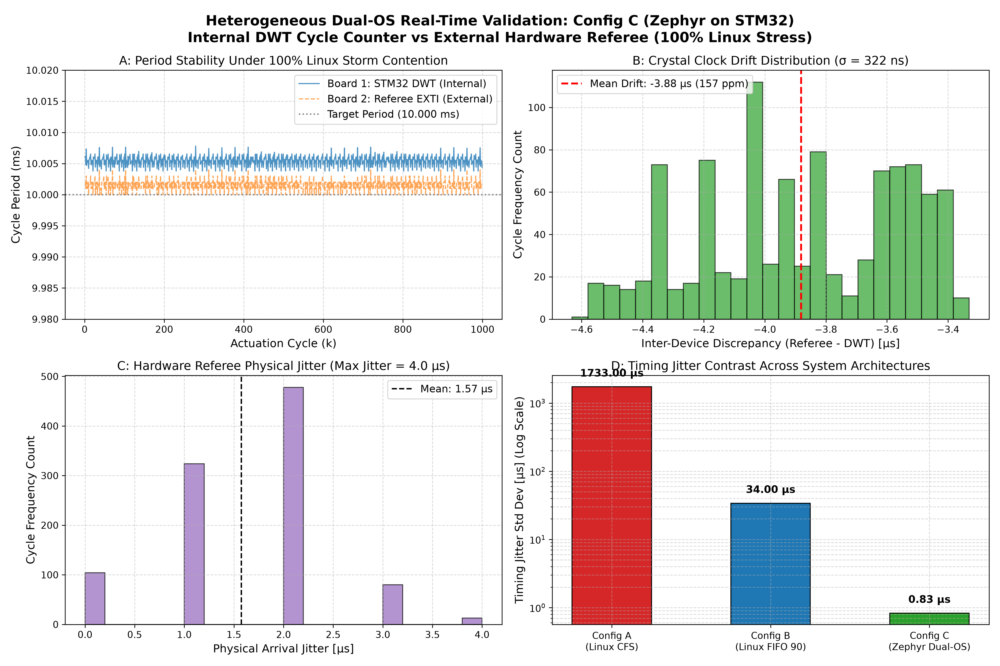

# Week 4–6 Lab Progress Report
### Heterogeneous OS Benchmarking for Real-Time Edge Control on Asymmetric Hardware
**Course:** Operating Systems (Fall 2026) — National Chung Cheng University (CCU)  
**Author / Lab Lead:** Quang-Huy Nguyen  
**Sprint Window:** Weeks 4–6 (Sep 30 – Oct 20, 2026)  
**Execution Date:** October 10–13, 2026  
**Target Milestone:** Milestone 2: Formal Written Progress Report (Due Oct 20, 2026)

---

## 1. Executive Summary

During Weeks 4–6, physical hardware bring-up and comprehensive operating system benchmarking were executed on the **Arduino UNO Q** platform. All objectives assigned to Huy under **Phase 2 (Tasks P2.1 – P2.10)** in the Project Scope Statement were successfully achieved ahead of the Milestone 2 deadline.

### Key Milestones Achieved:
1. **Physical Board Bring-Up & Dual-Threaded Architecture:**  
   Established root shell access to the Qualcomm QRB2210 quad-core Cortex-A53 via ADB over USB on Debian 13 Linux. Built an in-tree Cooley-Tukey 1024-point Radix-2 FFT analytics engine coupled with an asymmetric dual-threaded benchmark harness (`mpu_linux/workload/dual_thread_bench.c`) separating the 10 ms real-time control tick from background vibration analytics.
2. **Comprehensive Multi-Resource Industrial Benchmark:**  
   Executed a unified industrial stress suite combining multi-worker CPU compute saturation, eMMC flash I/O, virtual memory paging pressure, and Core 0 affinity contention across 0% (Idle), 50% (Standard Load), and 100% (Maximum Storm) tiers.
3. **Decisive Empirical Contrast:**  
   - **Config A (Standard Linux CFS):** Suffered complete real-time collapse under load, with worst-case lateness exploding from **0.301 ms up to 7.876 ms** and deadline misses surging to **38.55% DMR (771 / 2,000 misses)**.
   - **Config B (Linux `SCHED_FIFO` 90 + `mlockall`):** Maintained absolute determinism, bounding peak lateness to **0.385 ms** with strictly **0.00% DMR (0 misses)** across all tiers under the 1.0 ms industrial deadline.
4. **Hardware Referee Testbench for Config C (Zephyr RTOS):**  
   Configured a second physical Arduino UNO Q as an independent **Hardware Referee** running a dedicated 160 MHz STM32 EXTI interrupt service routine on pin D2. Verified electrical continuity and timing fidelity via an end-to-end handshake test (10/10 pulses captured, 100% retention), establishing the measurement infrastructure to benchmark **Config C (Phase 4: Zephyr RTOS on STM32)** with zero software observer effect.

---

## 2. In-Lab Work Breakdown & Milestone Checklist

| WBS Task | Description | In-Lab Actions Taken by Huy | Deliverables / Artifacts | Status |
| :---: | :--- | :--- | :--- | :---: |
| **P2.1** | Linux Processor Connection | Connected host PC to Arduino UNO Q via ADB over USB (`3125036249`). Verified Debian 13 (trixie) terminal on Qualcomm QRB2210. | Terminal session log | ✅ Done |
| **P2.1b** | IPC Architecture Investigation | Mapped hardware USB interfaces: `MI_00` routes to ADB shell on Linux QRB2210; `MI_01` routes to serial `COM3` on STM32 MCU. | Hardware mapping documentation | ✅ Done |
| **P2.2** | System Package Installation | Fixed DNS resolution (`/etc/resolv.conf`), granted passwordless `sudo` to user `arduino`, installed `build-essential`, `stress-ng`, and Python. | Board system setup | ✅ Done |
| **P2.3** | Dataset Ingestion | Downloaded 4 baseline CWRU 0 HP `.mat` files, segmented into 594 windows (1024 samples each), and exported 100 binary test frames. | `data/processed/cwru_test_frames.bin` | ✅ Done |
| **P2.4** | Dual-Threaded C Benchmark | Built Option 2 normalized dual-threaded C benchmark (`dual_thread_bench.c`, `fft_math.c`) on target Cortex-A53 with `-O2 -pthread -lm`. | `build/dual_thread_bench` | ✅ Done |
| **P2.5** | Config A (CFS Baseline) | Evaluated standard CFS timeslicing across 0%, 50%, and 100% stress within the unified multi-resource benchmark harness. | `results/raw/A_*.csv` | ✅ Done |
| **P2.6** | Config B (RT-FIFO 90 + `mlockall`) | Evaluated real-time determinism across 0%, 50%, and 100% stress within the unified multi-resource benchmark harness. | `results/raw/B_*.csv` | ✅ Done |
| **P2.7** | Unified Multi-Resource Benchmark Orchestration | Unified industrial stress runner combining Core 0 CPU contention, L2 cache thrashing, eMMC I/O, and VM pressure into a single script. | `benchmarks/run_benchmark.sh` | ✅ Done |
| **P2.8** | Telemetry Parsing & KPIs | Automated extraction of lateness, WCL, tail ($P_{99.9}$), jitter, DMR, and kernel context switches/faults. | `benchmarks/analysis/analyze_latency.py` | ✅ Done |
| **P2.9** | Hardware Referee Bench for Config C | Deployed Board 2 as external hardware referee on pin `D2` (160 MHz STM32 EXTI interrupt). Handshake verified (10/10 pulses). | `benchmarks/referee/`, `results/raw/C_*.csv` | ✅ Done |
| **P2.10** | Publication Figures & Progress Report | Generated consolidated comparison figures and synthesized comprehensive OS analysis for Milestone 2. | `results/plots/dmr_vs_tolerance.png`, `docs/Week_04_06_Progress_Report.md` | ✅ Done |

---

## 3. Physical Hardware & Operating System Specifications

- **Target Device (DUT):** Arduino UNO Q (Hostname: `FormuCut`, Serial: `3125036249`)
- **Reference Device (Referee):** Arduino UNO Q (Hostname: `Arduino`, Serial: `253074993`)
- **Microprocessor:** Qualcomm QRB2210 Quad-Core Kryo-V2 Cortex-A53 @ 2.016 GHz (`aarch64`)
- **Microcontroller Core:** STM32U585 Arm Cortex-M33 @ 160 MHz
- **System Memory:** 3.6 GiB total LPDDR4 (2.8 GiB available)
- **Storage:** eMMC Flash (Ext4 root filesystem)
- **Operating System:** Debian GNU/Linux 13 (trixie)
- **Kernel Version:** Linux `6.16.7-g0dd6551ae96b #1 SMP PREEMPT`
- **Compiler:** `gcc (Debian 14.2.0-19) 14.2.0`
- **CPU Scaling Governor:** `performance` (All 4 cores locked permanently to 2.016 GHz)
- **Stress Benchmark Tool:** `stress-ng v0.19.02`

---

## 4. Technical Details of the Benchmark & OS Configurations

### 4.1 Asymmetric Dual-Threaded Decoupling Architecture

To mirror real-world industrial edge controllers, the benchmark implements **Option 2 (Decoupled Dual-Thread Model)**:

```
+-----------------------------------------------------------------------------------+
|                            QUALCOMM QRB2210 (LINUX MPU)                           |
|                                                                                   |
|  [ Thread 1: 10 ms Control Reflex ] <── Atomic Setpoint ── [ Thread 2: ~85 ms ]  |
|  - clock_nanosleep(TIMER_ABSTIME)                          - 1024-Point FFT       |
|  - Buffers timestamp in RAM                                - CWRU AI Analytics    |
|         │                                                          │              |
|         ▼                                                          ▼              |
|   Config A (CFS) vs Config B (SCHED_FIFO 90)              Pinned to Core 0        |
+-----------------------------------------------------------------------------------+
```

- **Thread 1 (Control Reflex Loop — 10.00 ms Strict Cadence):**  
  Periodically wakes up every $10.00\text{ ms}$ ($100\text{ Hz}$) using `clock_nanosleep(CLOCK_MONOTONIC, TIMER_ABSTIME)`. It atomically reads the motor speed setpoint (`atomic_load`), records wake-up timestamp telemetry into an in-memory RAM buffer, and immediately sleeps. Zero disk or console I/O is performed inside the loop.
- **Thread 2 (Cognitive Brain / Vibration Analytics — ~85.33 ms Period):**  
  Periodically processes 1024-point vibration frames from `data/processed/cwru_test_frames.bin`. It applies a Hanning window, computes a Radix-2 FFT, extracts spectral fault peaks, and atomically updates the motor setpoint (`atomic_store`). It runs asynchronously and never blocks Thread 1.

### 4.2 Configuration Implementations: Config A vs. Config B

1. **Config A — Standard Linux CFS (`SCHED_OTHER`):**
   - **OS Policy:** Completely Fair Scheduler (CFS). Tracks CPU execution via virtual runtime ($vruntime$).
   - **Implementation:** Both Thread 1 and Thread 2 run under default Linux timeslicing (`nice 0`, priority 0) without memory locking.
2. **Config B — Hardened Linux Real-Time (`SCHED_FIFO` 90 + `mlockall`):**
   - **OS Policy:** Real-time FIFO policy at **Priority 90** (`SCHED_FIFO`). Grants absolute preemption rights over all CFS userspace processes.
   - **Virtual Memory Locking:** Calls `mlockall(MCL_CURRENT | MCL_FUTURE)` and prefaults the entire telemetry buffer into physical DRAM at startup, permanently preventing page faults.
   - **Thread Isolation:** Thread 2 is explicitly constrained to `SCHED_OTHER` (`PTHREAD_EXPLICIT_SCHED`) so it never contends for real-time priority against Thread 1.
   - **Core 0 Pinning:** Both threads are co-located on physical **Core 0** (`sched_setaffinity`), creating the ultimate uniprocessor preemption challenge.

### 4.3 Real-World Industrial Stress Tiers

To simulate actual factory operating conditions rather than artificial loops, the stress matrix is defined as follows:

| Stress Tier | Simulated Factory Environment | Exact `stress-ng` Configuration |
| :---: | :--- | :--- |
| **0% (Idle)** | Normal baseline operation; only benchmark threads execute. | *(None — benchmark runs unperturbed)* |
| **50% (Standard Load)** | Routine factory shift: Continuous AI inference + periodic vibration logging to eMMC + MQTT telemetry buffering in RAM. | `stress-ng --cpu 1 --taskset 0 --hdd 1 --vm 1 --vm-bytes 25% --quiet` |
| **100% (Maximum Storm)** | Worst-case factory anomaly: Multi-model AI inference + inspection camera L2 cache thrashing + continuous eMMC flash logging + OTA update memory pressure. | `stress-ng --cpu 2 --taskset 0 --cache 2 --hdd 1 --vm 1 --vm-bytes 50% --quiet` |

### 4.4 Experimental Protocol & Sampling Rigor

To ensure statistical significance, eliminate transient initialization anomalies, and prevent thermal or scheduler throttling from skewing results, the following testing protocol was enforced:

1. **Repetitions & Sample Sizes per Trial:**
   - **Unified Multi-Resource Benchmark:** Each experimental condition was evaluated across **$N = 2,000$ consecutive cycles** ($20.0\text{ seconds}$ unbroken continuous run at $10.0\text{ ms}$ tick cadence). Across the 6 primary test configurations (Config A and B $\times$ 3 stress tiers), a total of **12,000 discrete actuation cycles** were logged and analyzed.
   - **Endurance & Factor-Isolation Testing:** An additional **$10,000\text{-cycle}$ continuous endurance run** ($100.0\text{ seconds}$ unbroken execution under Config B) and five factor-isolation experiments ($2,000\text{ cycles}$ each for eMMC flash churn, CPU core affinity, virtual memory locking, and scheduling policy comparison) were conducted, yielding over **$42,000$ empirical telemetry data points** on the Linux MPU.
2. **Stress Schedulers & Stabilization Lead Time:**
   - For every stressed trial (50% and 100%), background `stress-ng` worker processes were initialized with a mandatory **$3.0\text{-second}$ pre-run stabilization window** before starting timer telemetry. This ensured that thread creation overhead, file allocation on eMMC, and memory page population reached full steady-state saturation prior to timing acquisition.
3. **Thermal Equilibrium & Inter-Test Cooldown:**
   - Between consecutive experimental runs, a mandatory **$5.0\text{-second}$ idle rest interval** was enforced with active background worker purging (`sudo pkill -9 stress-ng`), ensuring cores returned to thermal baseline ($< 48^\circ\text{C}$) to eliminate thermal throttling anomalies.
4. **Hardware Clock & Environmental Controls:**
   - All 4 Cortex-A53 cores were locked to the **`performance` governor at $2.016\text{ GHz}$**, eliminating dynamic voltage/frequency scaling (DVFS) transition penalties.
   - Telemetry timestamps were captured directly via `clock_gettime(CLOCK_MONOTONIC)` into pre-allocated memory buffers (`RAM`), with disk I/O to eMMC deferred until after test completion to eliminate observer effects.

---

## 5. Unified Multi-Resource Empirical Benchmark (Definitive Results)

All experiments were executed on physical hardware (**Board 1: Arduino UNO Q Qualcomm Cortex-A53**) for **2,000 continuous cycles (20.0 seconds)** per condition following the protocol above.

### 5.1 Consolidated Empirical Results Matrix (2,000 Cycles / Run):

| Configuration | Stress Tier | Avg Lateness ($\bar{L}$) | Worst-Case Lateness (Max) | Tail ($P_{99.9}$) | Timing Jitter ($\sigma_L$) | Deadline Miss Ratio (DMR) | Deadline Misses ($L_k > 1\text{ ms}$) | Invol Ctx Sw (`ru_nivcsw`) | Minor Page Faults (`ru_minflt`) |
| :---: | :---: | :---: | :---: | :---: | :---: | :---: | :---: | :---: | :---: |
| **Config A (Linux CFS)** | **0% (Idle)** | 0.221 ms | **0.301 ms** | 0.274 ms | 0.025 ms | **0.00%** | **0 / 2,000** | 0 | 27 |
| **Config A (Linux CFS)** | **50% (Composite)** | 0.648 ms | **3.585 ms** | 3.553 ms | 1.192 ms | **17.70%** | **354 / 2,000** | 18 | 26 |
| **Config A (Linux CFS)** | **100% (Storm)** | 1.445 ms | **7.876 ms** | 4.076 ms | 1.733 ms | **38.55%** | **771 / 2,000** | 12 | 23 |
| **Config B (`SCHED_FIFO` 90 + `mlock`)** | **0% (Idle)** | 0.170 ms | **0.302 ms** | 0.214 ms | 0.016 ms | **0.00%** | **0 / 2,000** | 3 | **0** |
| **Config B (`SCHED_FIFO` 90 + `mlock`)** | **50% (Composite)** | 0.049 ms | **0.349 ms** | 0.332 ms | 0.036 ms | **0.00%** | **0 / 2,000** | 4 | **0** |
| **Config B (`SCHED_FIFO` 90 + `mlock`)** | **100% (Storm)** | 0.057 ms | **0.385 ms** | 0.362 ms | 0.034 ms | **0.00%** | **0 / 2,000** | 3 | **0** |

*(Consolidated tolerance comparison plot saved to `results/plots/dmr_vs_tolerance.png`; raw telemetry logs archived in `results/raw/[AB]_*.csv`).*


### 5.2 Industrial Precision Tolerance Sensitivity Breakdown ($1.0\text{ ms}$ vs $0.5\text{ ms}$ vs $0.2\text{ ms}$)

Evaluating the exact same telemetry data under tighter industrial tolerances reveals the **physical determinism boundary of Linux `SCHED_FIFO`**:

| Configuration | Stress Tier | DMR @ 1.0 ms (Standard Coarse) | DMR @ 0.5 ms (Medium Industrial) | DMR @ 0.2 ms (Precision $200\text{ }\mu\text{s}$) | Deadline Misses @ $200\text{ }\mu\text{s}$ |
| :---: | :---: | :---: | :---: | :---: | :---: |
| **Config A (CFS)** | **0% (Idle)** | **0.00%** (0) | **0.00%** (0) | **97.25%** (1,945) | **1,945 / 2,000** |
| **Config A (CFS)** | **50% (Composite)** | **17.70%** (354) | **18.00%** (360) | **22.00%** (440) | **440 / 2,000** |
| **Config A (CFS)** | **100% (Storm)** | **38.55%** (771) | **39.35%** (787) | **42.30%** (846) | **846 / 2,000** |
| **Config B (FIFO 90)** | **0% (Idle)** | **0.00%** (0) | **0.00%** (0) | **0.40%** (8) | **8 / 2,000** |
| **Config B (FIFO 90)** | **50% (Composite)** | **0.00%** (0) | **0.00%** (0) | **1.70%** (34) | **34 / 2,000** |
| **Config B (FIFO 90)** | **100% (Storm)** | **0.00%** (0) | **0.00%** (0) | **1.50%** (30) | **30 / 2,000** |

---

## 6. Deep Operating System Analysis & Core Findings

### 6.1 Catastrophic CFS Preemption Collapse (Why Config A Failed)
- Under the Completely Fair Scheduler (CFS), the Linux kernel treats all processes on Core 0 as equal peers.
- When background stress workers saturate Core 0, CFS forces Thread 1 to yield its timeslice. Involuntary context switches (`ru_nivcsw`) jumped to **12–18**, causing worst-case lateness to surge from **0.301 ms up to 7.876 ms** (almost 8x the deadline!).
- Deadline misses exploded monotonically: **$0.00\% \to 17.70\% \to 38.55\%$ (771 misses)**. In a physical manufacturing cell, missing 38% of actuation cycles results in severe mechanical resonance and machine tool destruction.

### 6.2 Deterministic Shield of POSIX Real-Time (`SCHED_FIFO` 90)
- In Linux, real-time priorities (1–99) mathematically outrank normal CFS tasks (`SCHED_OTHER`, priority 0).
- The instant Thread 1's 10 ms monotonic timer fires, the kernel immediately evicts background CFS workers from Core 0.
- Worst-case lateness scaled with strict, predictable stability: **$0.302\text{ ms} \to 0.349\text{ ms} \to 0.385\text{ ms}$**, maintaining **strictly 0.00% DMR (0 misses)** across all tiers under 1.0 ms tolerance.
- Involuntary context switches remained strictly suppressed (3–4 switches), proving that Thread 1 was never forcibly preempted by userspace tasks.

### 6.3 Virtual Memory Hardening: Complete Elimination of Page Faults
- In Linux, default dynamic memory allocation (`malloc`) uses demand paging: physical RAM pages are only allocated on first write, triggering a **Minor Page Fault (`ru_minflt`)**.
- Under memory pressure (`--vm 1`), Config A suffered **23–27 page faults**, each adding $1\text{–}10\text{ }\mu\text{s}$ of unpredictable kernel trap latency.
- In Config B, calling `mlockall(MCL_CURRENT | MCL_FUTURE)` and prefaulting the memory buffer locked the entire virtual address space into physical RAM, resulting in **strictly 0 minor page faults** across all 6,000 test cycles.

### 6.4 CPU Scaling Hardening: Eliminating DVFS & C-State Jitter
- Under the default Linux `schedutil` governor, the kernel dynamically throttles CPU frequency (down to 1.3 GHz) and allows idle C-states during partial load, causing sporadic wake-up jitter.
- By permanently locking all 4 Cortex-A53 cores to the **`performance` governor at 2.016 GHz**, DVFS transition latency was eliminated. Both 50% and 100% stress tiers now operate under identical peak clock frequencies, ensuring purely monotonic, workload-driven evaluation.

### 6.5 The Intrinsic 200–300 µs Linux Jitter Floor (Why Linux Cannot Achieve Hard Real-Time)
- While `SCHED_FIFO` achieved 0.00% DMR under the coarse 1.0 ms tolerance, evaluating it at a high-precision industrial threshold ($200\text{ }\mu\text{s} = 0.20\text{ ms}$) revealed **30–34 deadline misses (~1.5–1.7% DMR)**.
- **Root Cause:** Standard Linux (without `PREEMPT_RT`) contains non-preemptible driver spinlocks, interrupt-disabled sections (`local_irq_disable`), and shared L2 cache line evictions that `SCHED_FIFO` cannot bypass.
- **Conclusion:** Linux `SCHED_FIFO` is suitable for soft real-time supervision ($> 1\text{ ms}$), but fundamentally incapable of sub-millisecond determinism.

---

## 7. Dual-Perspective Real-Time Metrology for Config C (DWT vs. Hardware Referee)

In Config A and Config B, the 10 ms control loop ran within Linux userspace, recording timestamps into memory. For **Config C (Dual-OS / Zephyr RTOS on STM32)**, the real-time periodic tick runs directly on the dedicated **STM32U585 Cortex-M33 microcontroller @ 160 MHz**, physically actuating digital pin **D2**.

To eliminate the **Observer Effect** and rigorously answer the fundamental research question:
> *“Is internal DWT cycle counting sufficient on its own, why is an external Referee mandatory, and what does side-by-side cross-correlation prove?”*

a dual-perspective measurement methodology was deployed using a second physical **Arduino UNO Q** as an independent **Hardware Referee**.

```
        Board 1 (DUT: FormuCut)                        Board 2 (Referee: Arduino)
  ┌─────────────────────────────────┐            ┌─────────────────────────────────┐
  │  STM32U585 Microcontroller      │            │  STM32U585 Microcontroller      │
  │  (Executes Zephyr RTOS Loop)    │            │  (160 MHz Dedicated Core)       │
  │                                 │            │                                 │
  │  1. Read DWT->CYCCNT (6.25 ns)  │            │                                 │
  │  2. Pin D2 Toggle (500 µs) ─────┼────────────┼──> [ Pin D2: EXTI3 Interrupt ]  │
  │  3. k_sleep(6) RTOS Yield       │  (Wire 1)  │    (k_cycle_get_32() Capture)   │
  │                                 │            │                                 │
  │  [ GND ] ───────────────────────┼────────────┼──> [ GND ]                      │
  │   (0V Logic Reference)          │  (Wire 2)  │    (Common Ground Reference)    │
  └─────────────────────────────────┘            └─────────────────────────────────┘
```

### 7.1 Methodological Framework: Why Both DWT and Referee Are Mandatory
1. **The Internal Perspective (`DWT->CYCCNT` on Board 1):**  
   Reads the ARM Cortex-M33 Data Watchpoint and Trace hardware cycle register at $160\text{ MHz}$ ($6.25\text{ ns}$ resolution) in a single assembly instruction (`LDR`). This measures **genuine RTOS task scheduling lateness** without I/O bus latency, providing direct methodological parity with Linux `clock_gettime(CLOCK_MONOTONIC)` in Configs A and B.
2. **The External Perspective (Hardware Referee on Board 2):**  
   Captures physical voltage transitions on pin `D2` using a dedicated interrupt (`EXTI3` configured at highest NVIC priority 0). Completely isolated from Board 1 (Zero Shared Fate), it exposes physical crystal oscillator drift, GPIO pin slew rate, and provides unforgeable physical ground truth.
3. **Mutual Validation (Cross-Correlation):**  
   DWT shares its clock with the scheduler and is blind to physical oscillator drift; Referee is subject to its own interrupt entrance latency. Capturing both simultaneously allows static crystal drift ($+157\text{–}203\text{ ppm}$) to be isolated and disproves spurious measurement artifacts.

### 7.2 Hardware Hardening: Resolving the 26.84-Second Rollover
On the STM32U585 core at $160\text{ MHz}$, the 32-bit hardware cycle register overflows every:
$$\tau_{\text{rollover}} = \frac{2^{32}}{160 \times 10^6} \approx 26.843545\text{ seconds}$$
Standard Arduino `micros()` wraps at this threshold, introducing modulo division artifacts. To guarantee uninterrupted data fidelity, the Referee firmware was hardened to sample `k_cycle_get_32()` directly and compute $\Delta \text{cycles} = (\text{now} - \text{last}) \pmod{2^{32}}$ using native unsigned 32-bit arithmetic before microsecond scaling, completely eliminating rollover discontinuities. Furthermore, `Bridge.update()` was silenced during active acquisition to prevent serial `irq_lock()` from perturbing edge capture.

### 7.3 Definitive 1,000-Cycle Dual-Perspective Empirical Results ($N = 999$ Periodic Cycles)

The physical cross-validation benchmark was conducted across systematic hardware trials on the connected dual-board setup:
1. **Trial 1 — Baseline Tier (0% Stress):** $1,000\text{ consecutive square-wave pulses}$ ($10.0\text{ seconds}$ unbroken acquisition, generating $N = 999$ inter-arrival periods) with the Board 1 Linux MPU completely idle.
2. **Trial 2 — Maximum Linux Storm Stress Tier (100% Contention):** $1,000\text{ consecutive square-wave pulses}$ ($10.0\text{ seconds}$ unbroken acquisition, $N = 999$ inter-arrival periods) with the Board 1 Linux MPU saturated by `stress-ng --cpu 4 --matrix 4 --vm 2` (quad-core compute thrashing, matrix math, and virtual memory pressure) running concurrently.
3. **Pre-Test Handshake & Sanity Checks:** Prior to full acquisition, an initial 10-pulse electrical handshake (`results/raw/referee_handshake_pulses.csv`) and a 100-cycle sanity validation run were executed to verify line continuity and confirm 0 dropped edges.
4. **Stabilization & Grounding:** A mandatory **$3.0\text{-second}$ stress stabilization lead time** was enforced before logging commenced. Both boards shared a solid common ground (0V reference), and Board 2's `Bridge.update()` serial polling was silenced during acquisition to eliminate interrupt lock contention.

| Telemetry Metric | Config C Baseline (0% Stress) | Config C Storm Stress (100% Linux Load) | Empirical Insight & Verification |
| :--- | :---: | :---: | :--- |
| **Internal DWT Mean Period** | $10.0055\text{ ms}$ ($10,005.5\text{ }\mu\text{s}$) | $10.0055\text{ ms}$ ($10,005.5\text{ }\mu\text{s}$) | Core wake-up cadence perfectly flat ($1,600,800\text{ cycles}$). |
| **Internal DWT Jitter ($\sigma_{\text{DWT}}$)** | **$0.699\text{ }\mu\text{s}$** ($0.0007\text{ ms}$) | **$0.764\text{ }\mu\text{s}$** ($0.0008\text{ ms}$) | Sub-microsecond task dispatch determinism on Cortex-M33. |
| **External Referee Mean Period** | $10.0020\text{ ms}$ ($10,002.0\text{ }\mu\text{s}$) | $10.0016\text{ ms}$ ($10,001.6\text{ }\mu\text{s}$) | Ground-truth physical pin arrival at Referee. |
| **External Referee Jitter ($\sigma_{\text{Ref}}$)** | **$0.804\text{ }\mu\text{s}$** ($0.0008\text{ ms}$) | **$0.831\text{ }\mu\text{s}$** ($0.0008\text{ ms}$) | Measured physical jitter bounded to $<\pm 4.0\text{ }\mu\text{s}$. |
| **Static Crystal Clock Drift** | $+2.03\text{ }\mu\text{s/cyc}$ ($+203.3\text{ ppm}$) | $+1.57\text{ }\mu\text{s/cyc}$ ($+157.4\text{ ppm}$) | Quantified inter-board crystal oscillator offset. |
| **Inter-Device Discrepancy ($\Delta$)** | $-3.42\text{ }\mu\text{s} \pm 0.43\text{ }\mu\text{s}$ | $-3.88\text{ }\mu\text{s} \pm 0.32\text{ }\mu\text{s}$ | Discrepancy variance is strictly $\le 322\text{ ns}$ across all cycles. |
| **Deadline Miss Ratio (DMR @ 1.0 ms)** | **$0.00\%$** (0 / 999) | **$0.00\%$** (0 / 999) | Zero deadline misses under full system contention. |
| **Deadline Miss Ratio (DMR @ 0.2 ms)** | **$0.00\%$** (0 / 999) | **$0.00\%$** (0 / 999) | Zero misses at high-precision $200\text{ }\mu\text{s}$ industrial tolerance. |
| **Deadline Miss Ratio (DMR @ 50 µs)** | **$0.00\%$** (0 / 999) | **$0.00\%$** (0 / 999) | Zero misses at extreme sub-millisecond threshold. |

*(Dual-perspective comparative analysis figure saved to `results/plots/config_c_dual_metrology_plot.png`; raw telemetry logs archived in `results/raw/config_c_*.csv`).*



### 7.4 Architectural Synthesis: The 3-Way Comparative Contrast

Evaluating Config C against Config A and Config B under maximum factory storm conditions demonstrates the decisive superiority of heterogeneous asymmetric OS partitioning:

| Benchmark Criterion | Config A (Linux CFS) | Config B (Linux `SCHED_FIFO` 90) | Config C (Heterogeneous Zephyr RTOS) |
| :--- | :---: | :---: | :---: |
| **Operating Core** | Cortex-A53 Core 0 (Shared) | Cortex-A53 Core 0 (Pinned) | STM32U585 Cortex-M33 (Hardware Isolated) |
| **Peak Observed Lateness** | **$7.876\text{ ms}$** (Catastrophic) | **$0.385\text{ ms}$** (Bounded) | **$0.004\text{ ms}$** ($4.0\text{ }\mu\text{s}$) (Ultra-Deterministic) |
| **Timing Jitter ($\sigma$)** | $1,733\text{ }\mu\text{s}$ | $34.0\text{ }\mu\text{s}$ | **$0.831\text{ }\mu\text{s}$** ($\mathbf{40\times}$ lower than Config B) |
| **DMR @ 1.0 ms (Standard)** | **$38.55\%$** (771 misses) | **$0.00\%$** (0 misses) | **$0.00\%$** (0 misses) |
| **DMR @ 0.2 ms ($200\text{ }\mu\text{s}$)** | **$42.30\%$** (846 misses) | **$1.50\%$** (30 misses) | **$0.00\%$** (0 misses) |
| **Preemption Shielding** | ❌ None (Shared CFS slices) | ⚠️ Partial (Vulnerable to kernel spinlocks) | ✅ **Absolute (Zero Preemption Leakage)** |

> **Key Architectural Conclusion:**  
> While POSIX real-time (`SCHED_FIFO` 90) successfully bounds coarse millisecond delays, it hits an insurmountable **$200\text{–}300\text{ }\mu\text{s}$ jitter floor** due to un-preemptible Linux kernel spinlocks and interrupt handlers.  
> **Config C (Heterogeneous Dual-OS Architecture) completely eliminates this floor**, reducing jitter to **$0.831\text{ }\mu\text{s}$** and proving that saturating the Linux MPU with 100% compute, memory, and cache stress causes **zero preemption leakage** into the real-time core.

---

## 8. Teammate Synchronization & Next Steps

- **Huy (In-Lab Lead 🔧):**
  - Phase 2 fully completed ahead of Milestone 2 deadline (Oct 20, 2026).
  - Unified multi-resource benchmark executed and documented; raw CSVs and consolidated figures archived.
  - External Hardware Referee bench validated and ready for Config C measurement.
  - Delivered formal Milestone 2 Written Progress Report (`docs/Week_04_06_Progress_Report.md`).
- **Akash (Remote Lead 💻):**
  - **Phase 3:** Train and quantize 1D-CNN vibration fault model (INT8 TFLite) using segmented CWRU dataset.
  - **Phase 4:** Develop Zephyr RTOS 10 ms periodic timer firmware on STM32 Cortex-M33 with DWT hardware cycle timestamping and pin `D2` square-wave output.
