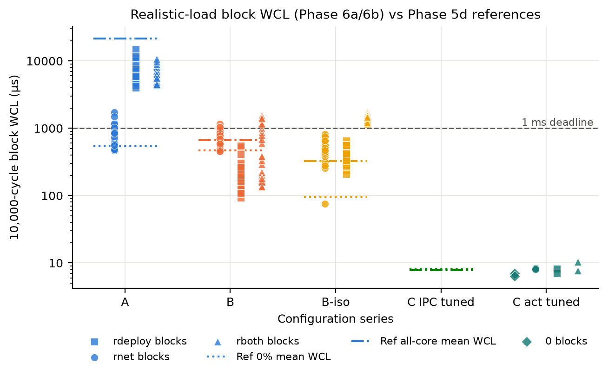
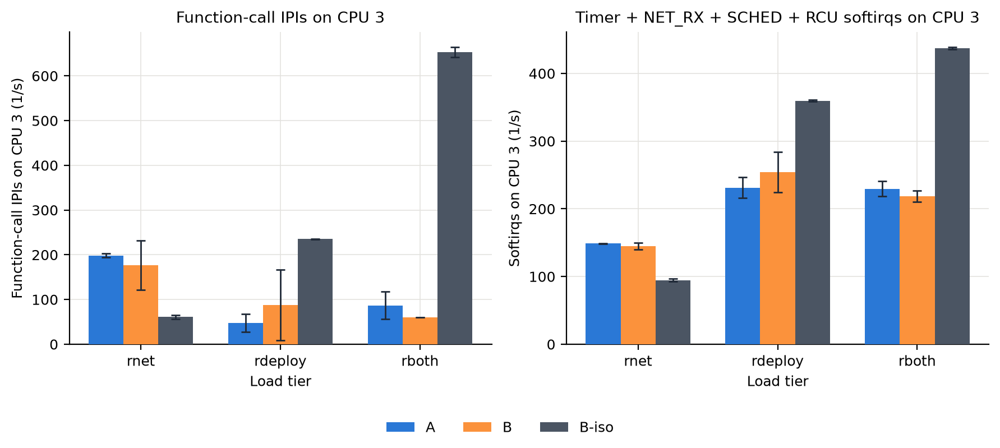

# Week 11 Lab Progress Report
### Heterogeneous OS Benchmarking for Real-Time Edge Control on Asymmetric Hardware
**Course:** Operating Systems (Fall 2026) — National Chung Cheng University (CCU)  
**Author / Lab Lead:** Quang-Huy Nguyen  
**Sprint Window:** Week 11 (Nov 18 – 24, 2026)  
**Execution Dates:** board runs Nov 17–18, analysis and review Nov 18, 2026  
**Target Milestone:** Milestone 3: 25-minute presentation and demo (**Dec 1, 2026**; results due Nov 28, slides Nov 29–30)

> **Status (Nov 18, 2026).** All realistic-load experiments (Phase 6a) and the full chain to an emulated motor drive (Phase 6b) are **finished, analysed and reviewed**: 2 repeats of every condition, 26 measured runs. The M3 measurement work is complete. Every number below comes from a script output on `results/raw/`; the source file is named under each table. Open team items are marked **[TBD]**.

---

## 1. Executive Summary

**Question:** can a 10 ms control loop keep its deadline while the same board does the heavy Linux work a deployed edge controller really does: network traffic and AI inference in a container?

**Answer, under the heaviest realistic load (network burst + containerised CNN at the same time):**

| Where the 10 ms loop runs | Worst-case lateness | Cycles later than the 1 ms deadline |
| :--- | ---: | ---: |
| A: Linux, default scheduler | 8.4–10.7 ms | 2.4–4.7 % |
| B: Linux, `SCHED_FIFO` 90 + `mlockall` | 1.45–1.54 ms | 0.014–0.036 % |
| B-iso: B on a reserved core | 1.59–1.72 ms | 0.16–0.31 % |
| **C: MCU loop, setpoints from Linux** | **0.0076–0.0105 ms** | **0** |

*Source: `results/phase6b/realload.md` (range over the 2 repeats).*

Three headline findings:
1. **Only the MCU keeps the deadline.** Config C's worst case is 150–200× smaller than the best Linux setup (B) and ≈ 1,000× smaller than default Linux (A), and it barely changes with load (6.3–10.5 µs from idle to the heaviest load).
2. **Every command arrives.** All 1,920 speed commands of the 8 Config C runs reached the emulated drive: 0 lost, 0 wrong, 0 extra; the drive saw each new command 1.47–4.11 ms after the tick.
3. **Isolating a core is not enough on a stock kernel.** B-iso (control thread alone on core 3) was *worse* than plain B under the combined load; the kernel's own work still reaches the reserved core.

---

## 2. Why These Experiments: the Factory Scenario

Our earlier tests used `stress-ng`, which creates busy programs. A real-time thread can always preempt a busy program, so `stress-ng` alone flatters Linux. A deployed edge controller also makes the **kernel** work: network interrupts, network processing, container networking, driver code. This week's experiments recreate that situation on purpose.

**The motivating example: CNC milling with a smart tool holder.** Sensory tool holders are real products. The SCHUNK iTENDO² holds an accelerometer and sends its data wirelessly to a receiver in the machine room ([SCHUNK](https://schunk.com/itendo2)); Fraunhofer's smartTOOL measures vibration, force and temperature at up to 10 kHz and powers itself from the spindle's rotation ([Fraunhofer IWU](https://www.iwu.fraunhofer.de/en/projects/smarttool.html)); pro-micron's spike sends force data over a 2.45 GHz radio ([CTE Magazine](https://ctemag.com/node/20374)). A recent study reports that wireless links inside a machine enclosure, next to a rotating sender, suffer packet loss and higher latency ([MDPI Sensors, 2026](https://www.mdpi.com/1424-8220/26/13/4302)).

In such a cell, the work splits into four layers with very different timing needs:

| Layer | In the factory | Deadline | In our experiment |
| :--- | :--- | :--- | :--- |
| **Sense** | Smart tool holder: vibration at ≈ 10 kHz, features per window, sent over a 2.4 GHz radio | none (best effort) | The PC streams real CWRU bearing vibration (12 kHz, 48 kB/s) to the board over Wi-Fi |
| **Think** | Digital Twin host (Linux): AI model detects chatter or tool wear, publishes to the MES (OPC UA / MQTT), also handles camera images and NC program downloads | **soft**: wear develops over minutes to hours | `rdeploy`: ONNX CNN in a Docker container on the board's Linux side; `rnet`: bulk network traffic (MES downloads, camera uploads) |
| **Act** | The loop that applies the speed / feed override every 10 ms | **hard**: a late tick means a wrong command on the machine | The 10 ms loop, on Linux (A, B, B-iso) or on the MCU (C) |
| **Drive** | Spindle drive receives the new speed | bounded by the drive | Board 3 receives the speed command as 500 Hz PWM |

**The key idea:** the analytics may be late; the control loop must not. Our experiments ask where the 10 ms loop has to live so that a busy "Digital Twin" on the same board cannot make it late.

*What is ours and what is assumed:* we did not use a real tool holder, radio or CNC. Product details above come from the cited sources; the mapping to our setup is our design.

---

## 3. Experiment Setup

### 3.1 Hardware

```
                Wi-Fi (bulk traffic, sensor stream)
     PC  ───────────────────────────────────────────►  DUT (UNO Q #1)
     │  USB / adb (control only)                       Linux: load + analytics (+ loop in A/B)
     │                                                 MCU:   10 ms loop (Config C)
     │                                                   │ D2 tick pulse   │ D3 speed command (PWM)
     │                                                   ▼                 ▼
     ├────────────────────────────────────────►  Referee (UNO Q #2)   Drive emulator (UNO Q #3)
     │                                           times every tick      records each new command
     └────────────────────────────────────────►  (D2)                  (D2 tick, D8 PWM)
                                     all grounds joined
```

| Board | Role | What it measures |
| :--- | :--- | :--- |
| DUT (UNO Q #1): Qualcomm QRB2210 (4× Cortex-A53, Debian 13, kernel 6.16 `PREEMPT`, **not** `PREEMPT_RT`) + STM32U585 MCU (Cortex-M33, 160 MHz) | Runs the load, the analytics and the 10 ms loop | Linux: wake-up time of every cycle; MCU: DWT cycle counter at every tick |
| Referee (UNO Q #2) | Times the DUT's tick pulse from outside with its own DWT counter | Interval between ticks, independent of the DUT's clock |
| Drive emulator (UNO Q #3) | Plays the motor drive | When each new PWM speed command arrives, and whether its value is right |
| Windows PC | Starts the runs over USB (adb), sends the network load, runs the analysis | Sender statistics |

### 3.2 Configurations

| Config | Where the 10 ms loop runs | What differs |
| :--- | :--- | :--- |
| **A** | Linux thread, default scheduler `SCHED_OTHER` (EEVDF since kernel 6.6, previously CFS) | Shares the CPUs fairly with everything else |
| **B** | Linux thread, `SCHED_FIFO` priority 90 + `mlockall` | Preempts every normal program; memory locked |
| **B-iso** | B, pinned to core 3 | Our load, the sampler and the movable interrupts (51 of 81) moved to cores 0–2; CPU idle states off. Isolation by affinity only: no `isolcpus` / `nohz_full` at boot |
| **C act** | MCU loop at thread priority 4 (above the RouterBridge thread) | Linux only computes setpoints and sends them over RouterBridge ("latest value wins"); the MCU applies them every tick and outputs them as PWM on D3 |

In every config the loop does the same minimal work; the FFT analytics run separately (Linux thread in A/B, Linux app in C), so only the OS behaviour differs.

### 3.3 Loads (what each one imitates)

| Tier | What runs | Factory meaning | Measured strength |
| :--- | :--- | :--- | :--- |
| **idle** (`0`) | nothing extra | quiet machine | — |
| **`rnet`** | PC sends bulk TCP over Wi-Fi as fast as possible; the board receives and discards it | network burst: NC program download, camera images, Digital Twin sync | 5.8–6.8 MB/s received |
| **`rdeploy`** | PC streams CWRU vibration at its real rate; a Docker container runs a 1D-CNN (ONNX Runtime, 3 threads) on every 1,024-sample window | the Digital Twin's AI model on the sensor stream | 46.6–54.1 kB/s; 11.7 inferences/s, 37–48 ms each (median); about 2 cores busy, partly spin-waiting (see §8) |
| **`rboth`** | both at once | a normal production shift | 6.3–6.8 MB/s + 11.7 inferences/s |

The CNN uses random weights on purpose: it is realistic background work, not a fault classifier. Its size was calibrated beforehand so one inference takes ≈ 40 ms on the board (`results/raw/real_calibration/`).

**Load checks.** Before, during and after every run the board checks that the load is really there (≥ 1 MB/s received for network tiers; ≥ 30 new inferences per 5 s for the CNN tiers). A run without load is stopped. All 60 checks in this report's runs passed (3 per Linux run, 1 per loaded Config C run).

*Sources: `results/phase6b/realload.md` (load evidence table), `realload_long.csv`.*

### 3.4 Protocol

| Item | Linux runs (A, B, B-iso) | Config C runs |
| :--- | :--- | :--- |
| Length | 180,000 cycles = 30 min per config | 10,000 cycles = 100 s (MCU memory limit) |
| Sequence | A, then B, then B-iso; for each: load on, 30 s warm-up, run, load off, 60 s cooldown | 20-cycle wiring check, then load on and the run |
| CPU frequency | all cores fixed at 2.016 GHz (`performance`) | board default (`schedutil`) |
| Repeats | 2 per tier (`rnet` / `rdeploy` Nov 17–18; `rboth` both on Nov 18) | 2 per tier (Nov 18) |
| Temperature | max 64.8 °C, no thermal throttling in any run | same |

Comparing Linux (30 min) with C (100 s): we also split every Linux run into 10,000-cycle blocks, so both are compared over the same number of cycles ("block WCL" in the figure below).

### 3.5 What we measure

- **Lateness** of each tick against the ideal 10 ms schedule, **relative to the run's best cycle** (`L_rel`; for Config C, the constant clock offset is removed by fitting the period). One definition for all configs.
- **WCL** (worst-case lateness), **DMR** (share of cycles more than 1 ms late), σ (jitter).
- **Full chain (C only):** for every setpoint change: was it delivered (lost / wrong / extra), how long from the tick until the drive saw it (`drive_seen`), the Linux→MCU round trip.
- **Load evidence:** per-CPU interrupt and softirq counts, network bytes, inference count, temperature, frequency.

### 3.6 Predictions written before the runs

We wrote 15 predictions down before any run and did not change them afterwards: R1–R6 (Nov 16, realistic load), F1–F4 (Nov 17, full chain), G1–G5 (Nov 18, combined load, written after repeat 1 of the single tiers). Section 5 states which held.

---

## 4. Results

### 4.1 Timing of the 10 ms loop

| Config | Tier | WCL µs mean [min–max] | Typical block WCL µs | DMR @ 1 ms max |
| :--- | :--- | ---: | ---: | ---: |
| A | `rnet` | 1,601 [1,489–1,713] | 605 | 0.00 % |
| A | `rdeploy` | 13,395 [11,827–14,963] | 5,818 | 1.55 % |
| A | `rboth` | 9,547 [8,364–10,730] | 5,572 | 4.72 % |
| B | `rnet` | 1,074 [990–1,158] | 754 | 0.00 % |
| B | `rdeploy` | 533 [519–548] | 140 | 0.00 % |
| B | `rboth` | 1,492 [1,446–1,539] | 301 | 0.04 % |
| B-iso | `rnet` | 789 [758–821] | 529 | 0.00 % |
| B-iso | `rdeploy` | 610 [568–652] | 386 | 0.00 % |
| B-iso | `rboth` | 1,658 [1,591–1,725] | 1,452 | 0.31 % |
| C act | idle | 6.7 [6.3–7.0] | 6.7 | 0 |
| C act | `rdeploy` | 7.6 [7.0–8.2] | 7.6 | 0 |
| C act | `rnet` | 8.2 [8.1–8.3] | 8.2 | 0 |
| C act | `rboth` | 9.1 [7.6–10.5] | 9.1 | 0 |

*Source: `results/phase6b/realload.md`, Timing Summary (2 runs per row). "Typical block WCL" = median of the worst case in each 10,000-cycle block.*



*Each point is the worst case of one 10,000-cycle block; dashed line = 1 ms deadline; horizontal markers = the same config under `stress-ng` (0 % and all-core). Source: `results/phase6b/block_wcl.png`.*

How to read it: A's blocks sit at 4–15 ms whenever the CNN runs. B stays below 1 ms under the CNN alone but crosses it when network traffic is added. B-iso under `rboth` is above 1 ms in almost every block. Config C sits at 6–11 µs in every tier, two to three orders of magnitude lower.

### 4.2 The full chain: does every command reach the drive?

| Tier | Commands | Lost | Wrong | Extra | Drive sees command: median / p99 / max | Linux→MCU round trip p99 |
| :--- | ---: | ---: | ---: | ---: | :--- | ---: |
| idle | 480 | 0 | 0 | 0 | 2.77 / 4.08 / 4.11 ms | 12.8 ms |
| `rdeploy` | 480 | 0 | 0 | 0 | 2.86 / 4.08 / 4.11 ms | 14.7 ms |
| `rnet` | 480 | 0 | 0 | 0 | 2.79 / 4.07 / 4.10 ms | 12.7 ms |
| `rboth` | 480 | 0 | 0 | 0 | 2.79 / 4.08 / 4.10 ms | 15.7 ms |

*Source: `results/phase6b/drive.md` (2 runs × 240 commands per tier).*

The drive-side delay (1.47–4.11 ms) is the same at idle and under every load: it is set by the MCU and the PWM itself (wait for the next 2 ms PWM period plus the high time), not by Linux. Linux load only stretches how long the *setpoint* takes to reach the MCU (round trip 12.8 → 15.7 ms), and the loop never waits for it.

### 4.3 What the kernel does on the "reserved" core

| Config | Tier | Function-call interrupts on CPU 3 (per s) | Softirqs on CPU 3 (timer + net + sched + RCU, per s) |
| :--- | :--- | ---: | ---: |
| B | `rboth` | 60 | ≈ 220 |
| **B-iso** | `rboth` | **654** | **≈ 440** |
| B | `rdeploy` | 88 | ≈ 255 |
| **B-iso** | `rdeploy` | **235** | **≈ 360** |
| B | `rnet` | 177 | ≈ 145 |
| B-iso | `rnet` | 61 | ≈ 94 |



*Source: `results/phase6b/realload.md`, "Kernel work on CPU 3", and `cpu3_kernel_work.png` (means over 2 repeats; whole-run averages).*

---

## 5. Predictions: Which Held?

| # | Prediction (written before the runs) | Verdict | Deciding numbers |
| :--- | :--- | :--- | :--- |
| R1 | A under `rdeploy`: WCL between its idle and all-core values, DMR < 1 % | **partly** | WCL 11.8–15.0 ms (inside the range), but DMR 1.42–1.55 % |
| R2 | B under `rnet` worse than under all-core `stress-ng` (> 0.78 ms) | **holds** | 0.99 / 1.16 ms |
| R3 | B-iso under `rnet` ≤ 0.5 ms if the Wi-Fi interrupt is moved off core 3 | **fails** | interrupt moved, yet 0.82 / 0.76 ms |
| R4 | C: WCL < 20 µs, 0 misses under `rdeploy` and `rnet` | **holds** | 7.0–8.3 µs, 0 misses |
| R5 | Setpoint round trip under `rnet` higher than at idle | **fails** | 12.5–12.7 ms vs idle 12.8–13.0 ms |
| R6 | No thermal throttling under `rdeploy` | **holds** | max 62.3 °C, all cooling states 0 |
| F1 | Adding the PWM write does not disturb the tick (idle WCL ≤ 19.3 µs) | **holds** | 7.0 / 6.3 µs |
| F2 | Every command delivered: 0 lost / wrong / extra | **holds** | 0 / 0 / 0 in all runs |
| F3 | Drive sees every command within 1.4–4.3 ms; tier median within 0.3 ms of idle | **holds** | 1.47–4.11 ms; medians within 0.09 ms |
| F4 | C under `rdeploy` / `rnet`: WCL ≤ 20 µs, 0 misses | **holds** | 7.0–8.3 µs |
| G1 | C under `rboth`: same as F2–F4 | **holds** | 7.6 / 10.5 µs, 0 / 0 / 0 |
| G2 | B under `rboth` ≥ the worse of B `rnet` / `rdeploy` | **holds** | 1.54 ≥ 0.99; 1.45 ≥ 1.16 ms |
| G3 | A's miss rate under `rboth` ≥ under `rdeploy` | **holds** | 4.72 ≥ 1.42 %; 2.36 ≥ 1.55 % |
| G4 | B-iso under `rboth` > 0.5 ms | **holds** | 1.72 / 1.59 ms |
| G5 | The network burst does not starve the sensor stream (≥ 11.5 inferences/s) | **holds** | 11.7/s in all 8 `rboth` runs |

12 of 15 hold, 1 partly, 2 fail. The failures are informative (Section 6).

---

## 6. What It Means

### 6.1 In OS terms

- **A (fair scheduling):** the loop competes with the CNN's threads for CPU time and waits several milliseconds for its turn. CPU-heavy work (`rdeploy`) hurts most.
- **B (`SCHED_FIFO`):** preempts the CNN immediately (≈ 0.5 ms under `rdeploy`), but cannot preempt the kernel's interrupt handling and softirq work. Network traffic therefore pushes B above 1 ms; on a stock kernel these paths are not preemptible.
- **B-iso:** moving our programs and the movable interrupts away left core 3 as the only core with spare time. Under `rdeploy` and `rboth` it received far more kernel work than in plain B (function-call interrupts 654 vs 60 per second under `rboth`). This is **consistent with** B-iso's high lateness; the counters are run averages and do not prove the cause of each late cycle. Under `rnet` alone, CPU 3 got *less* work in B-iso than in B, yet B-iso still missed 0.5 ms (R3), so another mechanism may contribute (for example shared cache or memory traffic). A kernel trace on core 3 would settle it (future work).
- **C:** the loop runs on a separate processor with its own RTOS; Linux can only delay the *setpoint*, never the tick. Its worst case grows by only a few µs under load (cause not studied), far below any deadline.
- **R5:** the network burst does not slow the Linux setpoint sender, but the CNN's CPU load does (round trip up to 15.7 ms). The sender is a normal Linux process: it suffers from CPU contention, not from network interrupts.

### 6.2 In the factory example

Assumptions (not measured on a CNC): feed 6 m/min = 100 mm/s; one late 10 ms tick = the machine runs that long with the previous command.

| Loop runs on | Worst delay | Tool travel with the old command | Late ticks per hour (> 1 ms) |
| :--- | ---: | ---: | ---: |
| A: Digital Twin host, normal priority | 10.7 ms | 1.07 mm | 8,500–17,000 |
| B: Digital Twin host, top priority | 1.54 ms | 0.15 mm | 50–130 |
| B-iso: Digital Twin host, reserved core | 1.72 ms | 0.17 mm | 560–1,120 |
| **C: dedicated real-time MCU** | **0.0105 ms** | **0.001 mm** | **0** |

The design lesson matches how industry builds such cells: let the Digital Twin host be as busy as it likes (its advice may arrive ≈ 16 ms late, which is harmless for wear that develops over minutes), but run the loop that acts on the machine on a dedicated real-time processor. Truly fast protection (emergency stop) stays on separate safety hardware in any case.

---

## 7. Data Quality and Incidents

| Event | What happened | Effect on the data |
| :--- | :--- | :--- |
| `rnet` repeat 2 aborted (Nov 18, 03:48) | The PC ran low on memory and its tool environment stopped the traffic sender mid-run; the board's own load check detected the missing load and stopped the run as designed | Aborted files archived (not deleted, not in git) with a README; repeat 2 re-run completely and passed every check |
| Brief board contact during a run (Nov 18, ≈ 13:06) | A harness command was run to read its help text; the harness had no help option and briefly queried the boards (≈ 15 s) | No effect visible: worst case in that window 0.49 ms vs the run's typical block 0.66 ms. The harness now has `--help` and rejects unknown modes before any board contact |
| Unusual MCU clock check before one run | Pre-flight reading 9,983 instead of ≈ 7,970 cycles in 50 µs | The check had been interrupted by the loop; the run's own data shows the clock unchanged (0.64 ppm vs the referee) |
| Two definitions of a miss | First-look numbers used absolute lateness (e.g. A `rboth` 5.0 %); the official analysis uses lateness relative to the best cycle (4.7 %) | All tables here use the official definition |
| Different CPU frequency settings | Linux runs at a fixed 2.016 GHz, Config C runs at the board default | Favours Linux, not C; stated in the method |

---

## 8. Limitations

- **No real tool holder, radio or CNC.** The sensor stream comes from the PC over Wi-Fi; the radio's own latency and losses inside a machine are not part of the measurement.
- **Stock Linux kernel** (`PREEMPT`, not `PREEMPT_RT`): B and B-iso are not best-case real-time Linux; B-iso uses affinity only, no boot-time isolation.
- **One board set, emulated drive** (no motor); the CNN has random weights (background load).
- **The CNN's threads spin while waiting.** By default, ONNX Runtime lets idle worker threads spin (busy-wait: keep checking for work instead of sleeping) for slightly faster inference ([ONNX Runtime thread management](https://onnxruntime.ai/docs/performance/tune-performance/threading.html)). We kept the default, as a typical deployment would, so `rdeploy` and `rboth` occupy more CPU time than the inference itself needs (about 2 cores show ≈ 100 % busy). The spinning threads run at normal priority: they compete directly with A's control loop, are preempted at once by B's priority-90 thread, and are kept off core 3 in B-iso; the MCU loop of Config C is not affected. With spinning turned off, Linux would have more idle time, which may reduce A's lateness; we did not measure this.
- **Repeats:** 2 per realistic condition; the two `rboth` repeats ran in one session, so they show within-session spread, not day-to-day variation. A's miss rate varied most (2.4 vs 4.7 %).
- **Run length:** Linux runs are 180,000 cycles, Config C runs 10,000 (compared through 10,000-cycle blocks).

---

## 9. Engineering and Documentation

- Harness: `--help` added; unknown modes are rejected before any board is contacted (18 new tests).
- Analysis: per-CPU kernel work (`cpu_interference.csv`, "Kernel work on CPU 3"), all tables regenerated and checked byte-for-byte by a second run.
- Repository: README now opens with the key results and design decisions, plus a phase-by-phase map of where every result lives and a glossary of folder names; READMEs for `results/`, `docs/`, the analysis scripts and every board app.
- All data and results are committed; a pull request from `feature/phase5-ipc` into `main` is prepared.

---

## 10. Team Status and Next Steps

| When | Who | What |
| :--- | :--- | :--- |
| Nov 19–24 | Huy | Freeze results; prepare figures and numbers for the slides; merge the pull request |
| **[TBD]** | Akash (remote) | **[TBD: tasks this week]** |
| Nov 25–28 | Huy | Rehearse the demo; buffer for any re-check |
| Nov 29–30 | Akash | P5.5 slide deck (with Huy's figures and numbers) |
| Dec 1 | Huy and Akash | P5.6 presentation and demo (**[TBD: demo]**) |
| Dec–Jan 5 | both | M4 report (IEEE, ≤ 15 pages, results ≤ 8 pages) |

**Scheduler wording (agreed Nov 18):** Config A is described as "`SCHED_OTHER`, Linux's default fair scheduler (EEVDF since 6.6, previously CFS)".
